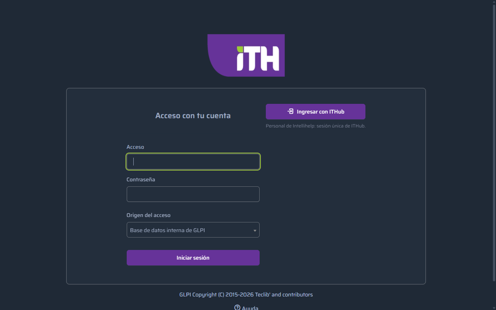
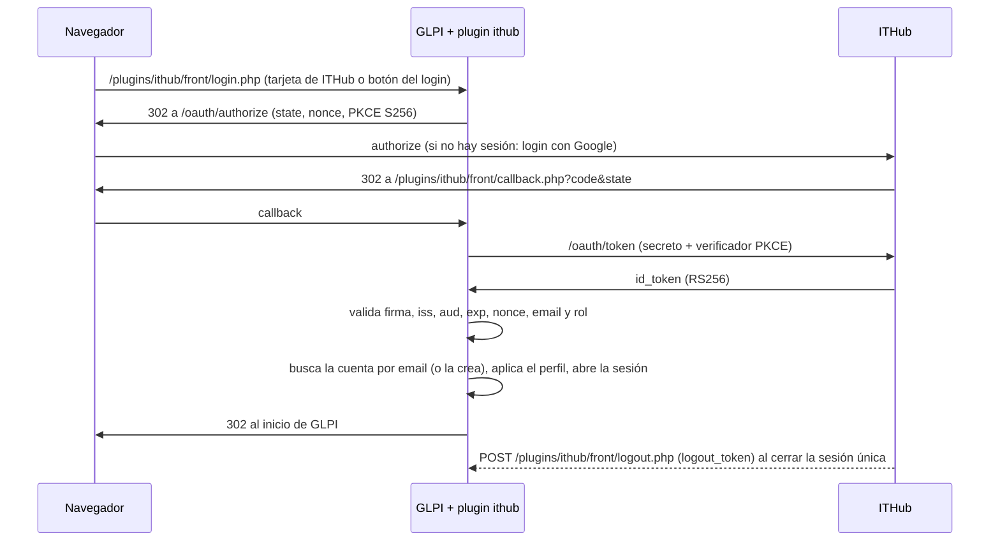

<h1 align="center">glpi-ithub</h1>

<p align="center">
  <b>Ingreso único de ITHub para la Mesa de Ayuda (GLPI 12) de Intellihelp.</b><br>
  El personal entra con la sesión única de ITHub (OpenID Connect). Los clientes siguen entrando con su usuario y contraseña de GLPI, sin cambios.
</p>

<p align="center">
  
  
  
  
  
  
  
</p>

<p align="center">
  
</p>

---

## Índice

- [Descripción](#descripción)
- [Cómo funciona](#cómo-funciona)
- [Roles y perfiles](#roles-y-perfiles)
- [Por qué un plugin propio](#por-qué-un-plugin-propio)
- [Estructura](#estructura)
- [Instalación](#instalación)
- [Despliegue](#despliegue)
- [Tests](#tests)
- [Seguridad](#seguridad)
- [Limitaciones conocidas](#limitaciones-conocidas)
- [Licencia](#licencia)

## Descripción

[ITHub](https://github.com/bsierra4262/ithub-portal) es el portal de Intellihelp: una sola
sesión de Google Workspace para todas las aplicaciones internas, con permisos por aplicación y
un proveedor **OpenID Connect** propio. Este repositorio conecta la **Mesa de Ayuda**
(`https://ayuda.intellihelp.tech`, GLPI 12.0) a esa sesión única.

| Antes | Ahora |
|---|---|
| El personal entraba con un usuario y contraseña propios de GLPI | Entra con la sesión de ITHub: si ya estaba adentro de ITHub, sin ver ninguna pantalla |
| El perfil se tocaba a mano en GLPI | El rol llega en el `id_token` (claim `rol`) y se aplica en cada ingreso |
| Salir de GLPI no cerraba nada más | «Salir» cierra la sesión única; y si la sesión se cierra en ITHub, GLPI la corta (back-channel logout) |
| Los clientes entraban con usuario y contraseña | **Igual que antes**: el formulario de siempre no cambia |

## Cómo funciona



1. **Arranque** (`front/login.php`). Es la dirección de la tarjeta *Mesa de Ayuda* en ITHub y
   del botón *Ingresar con ITHub* del login. Guarda `state`, `nonce` y el verificador PKCE en la
   sesión anónima de GLPI y manda a `/oauth/authorize`.
2. **Vuelta** (`front/callback.php`). Valida el `state` (un solo uso, 10 minutos), canjea el
   código servidor a servidor y valida el `id_token` entero: RS256 con la clave de
   `/oauth/jwks` (PEM armado desde el JWK, en caché una hora, se vuelve a bajar si rota el
   `kid`), `iss`, `aud`, `exp` y `nonce`. Exige email verificado de `@intellihelp.tech` y un
   rol conocido.
3. **Cuenta.** Busca la cuenta de GLPI por email. Si no existe, la crea (nombre de ingreso = el
   email, autenticación externa, sin contraseña). Si hay dos cuentas con el mismo email, o la
   cuenta está desactivada, no entra.
4. **Perfil.** Deja la cuenta con el perfil del rol de ITHub (ver abajo).
5. **Sesión.** Abre la sesión por la autenticación externa de GLPI (la misma que usa su SSO),
   activada **sólo en memoria y sólo durante ese pedido**. Ver [Seguridad](#seguridad).
6. **Cierre.** Guarda el `sid` de ITHub junto a la sesión de GLPI. Cuando ITHub avisa el cierre
   (`front/logout.php`, back-channel logout), el plugin revoca esas sesiones con el registro de
   sesiones de GLPI: quedan cerradas y su archivo borrado. «Salir» en GLPI manda a
   `/oauth/logout` de ITHub con `id_token_hint`, que cierra la sesión única y vuelve al login.

Sin `client_id` y `client_secret` en la configuración el plugin no hace nada.

## Roles y perfiles

Los roles de la app `ayuda` en ITHub son los perfiles de GLPI que usa el personal:

| Rol en ITHub | Perfil de GLPI | Quién lo tiene hoy |
|---|---|---|
| `admin` | Admin | jayala · `rol_superadmin` (los super admin de ITHub sin rol explícito) |
| `mesa` | Crear y Asignar Tickets | bsierra, lzaltron, lcampos |
| `tecnico` | Technician | — |
| `autoservicio` | Self-Service | — |

**Super-Admin no se puede dar desde ITHub**: queda sólo para la cuenta local `admin`.

Cómo se aplica el rol, sin perder en qué entidades trabaja cada uno:

- Las habilitaciones con un perfil del mapeo distinto del rol pasan al perfil del rol **en la
  misma entidad** (se agrega la nueva y después se borra la vieja: nunca queda sin perfil).
- Las habilitaciones con otros perfiles (Super-Admin, Observer…) y las dinámicas (reglas) no se
  tocan: son decisiones de un administrador de GLPI.
- Quien no tenía ninguna recibe el perfil en la entidad raíz, recursiva.
- El perfil del rol queda como perfil de inicio.

## Por qué un plugin propio

Se evaluaron dos caminos:

- **Un plugin de SSO por OAuth/OIDC de terceros.** Sólo sería aceptable uno que declare GLPI 12
  en su `setup.php`, y aun así agrega código ajeno con acceso a la autenticación de todos los
  usuarios (también los de clientes) y una dependencia más que hay que seguir en cada
  actualización. No se instaló ninguno.
- **El SSO nativo de GLPI por variable de servidor** (`ssovariables_id`, p. ej. `REMOTE_USER`)
  con un «portero» OIDC delante. Es el mecanismo oficial, pero activado en la configuración hace
  que GLPI confíe en esa variable **en todos los pedidos** y que exija la variable en cada pedido
  de la sesión.

La solución usa el segundo camino **sin activarlo**: el portero es un plugin de GLPI (el mismo
patrón que `ithosconfirma`), declara `12.0.0 – 12.0.99`, no modifica ningún archivo de GLPI ni
su configuración en la base, y usa la autenticación externa de GLPI sólo dentro del pedido de
vuelta, después de validar el token.

## Estructura

```
plugin/ithub/            el plugin (se copia a GLPI/plugins/ithub)
  setup.php              versión, requisitos, hooks: botón del login, páginas públicas, salida
  hook.php               instalación: tabla glpi_plugin_ithub_sessions (sid ↔ sesión de GLPI)
  inc/oidc.php           cliente OIDC sin dependencias de GLPI (se prueba solo)
  inc/glpi.php           cuenta, perfil, apertura de sesión, revocación, salida
  front/login.php        arranque del ingreso
  front/callback.php     vuelta de ITHub
  front/logout.php       aviso de cierre (back-channel logout)
config/ithub.example.php ejemplo de GLPI/config/ithub.php
bin/deploy.sh            copia el plugin al servidor (con respaldo) y verifica por HTTP
bin/alta-ithub.php       alta de la app en ITHub, secreto, config y permisos del personal
test/run.php             pruebas del cliente OIDC (sin GLPI ni red)
test/glpi-servidor.php   prueba dentro de GLPI con una cuenta temporal que se borra al final
```

## Instalación

Requisitos: GLPI 12.0.x, PHP 8.2+ con `openssl` y `curl`.

1. **Respaldo** de la base de GLPI: `~/backups/glpi-<fecha>.sql.gz`.
2. **Copiar el plugin**: `bin/deploy.sh` (o copiar `plugin/ithub` a `GLPI/plugins/ithub`).
3. **Instalar y activar** (crea la tabla `glpi_plugin_ithub_sessions`):
   ```bash
   php bin/console plugin:install ithub --username=admin
   php bin/console plugin:activate ithub
   ```
4. **Alta en ITHub y configuración**: `php bin/alta-ithub.php` (en seco) y después
   `php bin/alta-ithub.php --aplicar`. Deja en ITHub:

   | Dato | Valor |
   |---|---|
   | Tarjeta (`url`) | `https://ayuda.intellihelp.tech/plugins/ithub/front/login.php` |
   | URI de vuelta | `https://ayuda.intellihelp.tech/plugins/ithub/front/callback.php` |
   | URI después de salir | `https://ayuda.intellihelp.tech/` |
   | Aviso de cierre | `https://ayuda.intellihelp.tech/plugins/ithub/front/logout.php` |
   | Roles | `admin, mesa, tecnico, autoservicio` (`rol_superadmin`: `admin`) |

   y en el servidor `GLPI/config/ithub.php` y `GLPI/config/ithub-secreto-ayuda.txt` (600).
   El secreto nunca se imprime; la copia está en el repo privado `glpi-ithub-claves`.

Para desactivar el ingreso con ITHub alcanza con borrar `client_secret` de `GLPI/config/ithub.php`
(o desactivar el plugin): GLPI queda exactamente como antes.

## Despliegue

```bash
bin/deploy.sh          # copia el plugin (respaldo en ~/backups/glpi-plugin-ithub-<fecha>.tgz)
bin/deploy.sh --test   # además corre test/glpi-servidor.php en el servidor
```

Al final verifica por HTTP que el login de GLPI conserva su formulario y que el ingreso con
ITHub arranca con PKCE S256.

## Tests

```bash
php test/run.php       # 59 comprobaciones, sin GLPI ni red
```

Firma tokens con una clave RSA generada en el momento: PEM desde el JWK, firma, `aud`, `iss`,
vencimiento, `nonce`, `alg` (`none`, `HS256`), `kid`, logout_token (evento, sin nonce, sid/sub),
dominio del email, mapeo de roles, plan de perfiles, URL de autorización (PKCE) y de salida, y
destinos de redirección.

`test/glpi-servidor.php` (8 comprobaciones, en el servidor) crea una cuenta temporal, le cambia
el perfil, abre su sesión por la autenticación externa en memoria, comprueba que la
configuración vuelve a como estaba, que un `REMOTE_USER` previo no importa, que una cuenta
distinta de la esperada se rechaza y que `REMOTE_USER` solo no hace entrar a nadie. Al final la
borra.

## Seguridad

- **Nadie puede hacerse pasar por otro con una cabecera o variable.** `ssovariables_id` queda en
  `0` en la base: GLPI nunca lee `REMOTE_USER` ni ninguna cabecera para autenticar. El plugin lo
  prende en memoria sólo dentro de `callback.php`, después de validar el `id_token`, pisa
  `REMOTE_USER` con la cuenta resuelta y lo restaura al terminar. Si GLPI abre la sesión de una
  cuenta distinta de la esperada, se cierra y no entra.
- **Token validado entero**: RS256 únicamente, firma con la clave publicada por ITHub, `iss`,
  `aud`, `exp` (60 s de tolerancia), `nonce` de un solo uso, `state` de un solo uso con
  vencimiento y PKCE S256. El código se canjea servidor a servidor con el secreto.
- **Cuentas de clientes a salvo**: sólo emails verificados de `@intellihelp.tech` entran por
  ITHub, y la cuenta se busca por ese email exacto; con dos cuentas para el mismo email no se
  elige ninguna.
- **Sin escalar a Super-Admin**: ningún rol de ITHub da ese perfil.
- **Aviso de cierre**: sólo se acepta un `logout_token` firmado, para esta app, con el evento de
  back-channel y sin `nonce` (400 si no). No usa cookies ni CSRF porque lo llama el servidor de
  ITHub.
- **Salida**: el `id_token_hint` sólo viaja a ITHub al salir; las cuentas que no entraron por
  ITHub salen como siempre.
- **Secretos**: fuera del repositorio y del webroot (`GLPI/config/`, 600). El log del plugin
  (`files/_log/ithub.log`) nunca guarda tokens ni secretos.

## Limitaciones conocidas

- Las cuentas del personal que ya existían conservan su contraseña de GLPI: pueden seguir
  entrando con el formulario (nadie pierde el acceso). Cuando todos usen ITHub, se puede
  vaciar esa contraseña desde GLPI para que el único camino sea ITHub.
- Si algún día se activa el doble factor de GLPI para una cuenta, el ingreso por ITHub pasa
  por esa pantalla y la sesión que queda no tiene el `sid` (el aviso de cierre no la corta).
- El cierre por inactividad de GLPI no cierra la sesión de ITHub (a propósito, igual que en el
  CRM).

## Licencia

GPLv3 o posterior, como GLPI. Ver [LICENSE](LICENSE).

---

Hecho por **Brian Sierra** para INTELLIHELP.
